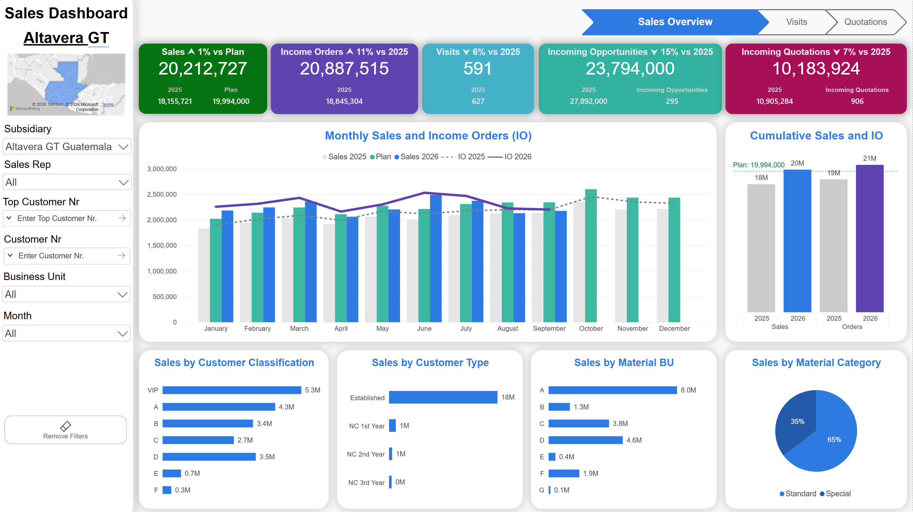

[English](#english-version) | [Español](#versión-en-español) 

## 🇺🇸 English Version

# BI Consultancy & Data Strategy

Hi, I'm **Andrea Contreras**, an independent consultant in Guatemala 🇬🇹. I specialize in transforming messy data into strategic assets. My focus is **interoperability**: I connect and optimize your data whether your company operates in **Microsoft 365** or **Google Workspace**.

## 🌎 Global Reach & Services
* **Trilingual Services:** Consulting and technical solutions in **Spanish (Native)**, **English (C1)**, and **German (C1)**.
* **European Professional Standards:** Academic and professional experience in **Austria 🇦🇹**, bringing precision, high-quality workflows and punctuality.
* **Global Remote Collaboration:** Available for strategic projects across **Latin America** and **Europe**.

### 🛠️ Technical Capabilities

| Analysis & Visualization | Automation & ETL | Apps & Databases |
| :--- | :--- | :--- |
| 📊 **Power BI** (DAX) | ⚙️ **Power Automate** | 📱 **Power Apps** |
| 📗 **Looker Studio** | ⚡ **Power Query (M)** | 🚀 **AppSheet / App Studio** |
| 📈 **Google Sheets / Excel** (Advanced) | 💻 **Google Apps Script** | 🗄️ **SQL** |

### 🚀 Solutions & Services
* **Unified Dashboards:** Consolidation of multiple sources (SQL, Excel, Sheets) into real-time control dashboards.
* **Financial Clarity:** Monitoring profitability, cash flow, and critical KPIs to support decision-making.
* **Data Capture Modernization:** Replacing paper-based forms with custom apps for data entry from mobile or tablet.
* **Automated Workflows:** System integration to trigger alerts and eliminate repetitive manual tasks.
* **Data Cleaning (ETL):** Transformation processes designed to eliminate human error, remove duplicates, and ensure data integrity.

### 📊 Projects

#### [Sales Performance Dashboard – Power BI](./powerbi-sales-performance-dashboard/)

Sales dashboard for a B2B manufacturer with sales teams in five countries. It brings together sales vs. plan and prior year, orders, visits, quotations and the sales funnel, with drill-through from customer to product. Delivered to the client in Power BI Service with scheduled automatic refresh, so nothing has to be updated manually.

Based on a real client project. The data shown is fictional and AI-generated to protect client confidentiality.

### 🏗️ Workflow Methodology
1. **Discovery:** Understanding the business problem and objectives, not just the data table.
2. **Modeling & Solution:** Structuring information to be fast, scalable, and accurate.
3. **Delivery:** Visualizations that tell a story and tools that save real time.

### 📚 Engineering Standards
As an organized professional committed to quality, I follow methodologies that ensure robust solutions. I maintain a technical knowledge base documenting the engineering standards applied in my projects:

* [📂 **Best Practices**](./Best-Practices/) — Internal development standards.
* [📖 **Knowledge Hub**](https://github.com/andrecontre/learning) — Central repository for advanced logic and master notes.

### 📫 Let's Talk
If your company has data but no answers, let's discuss how to turn it into growth.
* **LinkedIn:** [andreacontrerasflores](https://www.linkedin.com/in/andreacontrerasflores/)
* **Location:** Guatemala 🇬🇹 (on-site and remote services) and remote projects for LATAM & Europe.

*"The value is not in the data, but in what the data allows you to decide."*

---

# Consultoría de Inteligencia de Negocios y Estrategia de Datos

¡Hola! Soy **Andrea Contreras**, Consultora Independiente en Guatemala 🇬🇹. Me especializo en transformar datos desordenados en activos estratégicos, optimizando la operación de Pymes y empresas. Mi enfoque es la **interoperabilidad**: conecto y optimizo tus datos sin importar si tu empresa vive en el ecosistema de **Microsoft 365** o **Google Workspace**.

## 🌎 Alcance Global y Servicios
* **Servicios Trilingües:** Consultoría y soluciones técnicas en **Español (Nativo)**, **Inglés (C1)** y **Alemán (C1)**.
* **Estándares Europeos:** Experiencia académica y profesional en **Austria 🇦🇹**, garantizando precisión, flujos de trabajo de alta calidad y puntualidad.
* **Colaboración Remota:** Disponible para proyectos estratégicos en **Latinoamérica** y **Europa**.

## 🛠️ Capacidades Técnicas (Soluciones por Función)
Domino las herramientas líderes para adaptarme a la infraestructura que tu empresa ya posee:

| **Análisis y Visualización** | **Automatización de Procesos** | **Bases de Datos y Apps** |
| :--- | :--- | :--- |
| 📊 **Power BI** (DAX) | ⚙️ **Power Automate** | 📱 **Power Apps** |
| 📗 **Looker Studio** | ⚡ **Power Query (M)** | 🚀 **AppSheet / App Studio** |
| 📈 **Google Sheets / Excel** (Avanzado) | 💻 **Google Apps Script** | 🗄️ **SQL** |

## 🚀 Soluciones que implemento
* **Dashboards Unificados:** Consolidación de múltiples fuentes (SQL, Excel, Sheets) en tableros de control en tiempo real.
* **Claridad Financiera:** Monitoreo de rentabilidad, flujo de caja y KPIs críticos para la toma de decisiones.
* **Modernización de Captura:** Sustitución de formularios de papel por Apps personalizadas para ingreso de datos desde celular o tablet.
* **Flujos de Trabajo Automatizados:** Conexión entre sistemas para generar alertas o eliminar tareas manuales repetitivas.
* **Limpieza de Datos (ETL):** Procesos de transformación para eliminar errores humanos, duplicados y garantizar datos veraces.

## 📊 Proyectos

### [Sales Performance Dashboard – Power BI](./powerbi-sales-performance-dashboard/)

Dashboard de ventas para un fabricante B2B con equipos comerciales en cinco países. Reúne ventas vs. plan y año anterior, pedidos, visitas, cotizaciones y embudo de ventas, con drill-through de cliente a producto. Entregado al cliente en Power BI Service con actualización automática programada, sin tareas manuales.

Basado en un proyecto real. Los datos mostrados son ficticios y generados con IA para proteger la confidencialidad del cliente.

## 🏗️ Metodología de Trabajo
1. **Diagnóstico:** Entender el problema de negocio y los objetivos, no solo la tabla de datos.
2. **Modelado y Solución:** Estructurar la información para que sea rápida, escalable y veraz.
3. **Entrega:** Visualizaciones que cuentan una historia y herramientas que ahorran tiempo real.

## 📚 Estándares y Metodología Técnica
Como profesional organizada y comprometida con la calidad, sigo metodologías que garantizan soluciones robustas y mantengo una base de conocimientos técnica donde documento los estándares de ingeniería aplicados en mis proyectos:

* [📂 **Mejores Prácticas (Best Practices)**](./Best-Practices/) — Estándares internos de desarrollo.
* [📖 **Centro de Conocimiento**](https://github.com/andrecontre/learning) — Mi repositorio central de lógica avanzada y notas maestras.

## 📫 Contáctame
Si tu empresa tiene datos pero no tiene respuestas, hablemos de cómo convertirlos en crecimiento.
* **LinkedIn:** [andreacontrerasflores](https://www.linkedin.com/in/andreacontrerasflores/)
* **Ubicación:** Guatemala 🇬🇹 (servicios presenciales y remotos) y proyectos remotos en LATAM y Europa.

*"El valor no está en el dato, sino en lo que el dato te permite decidir."*
