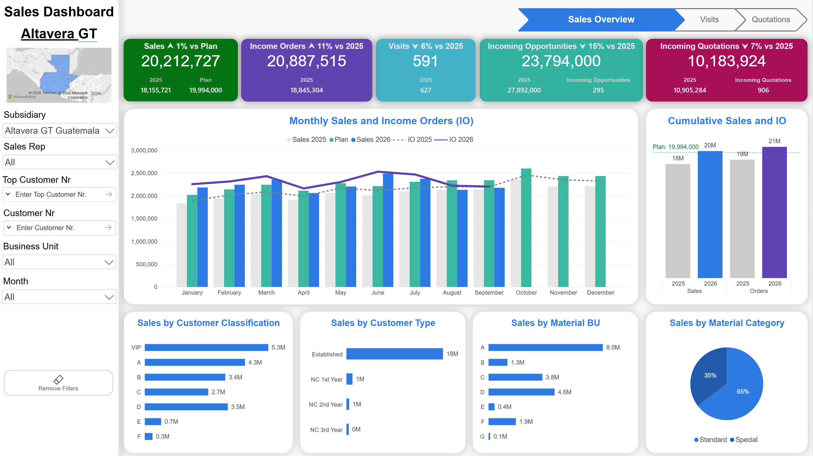

# Sales Performance Dashboard – Power BI

Power BI solution for a B2B manufacturer with sales teams in five countries. It brings sales vs. plan and prior year, incoming orders, visits, quotations and the lead-to-opportunity pipeline into one report, so sales managers can see where they stand and which customers and products need attention.

## What's inside

- **Overview:** KPI cards and monthly and cumulative sales vs. plan and incoming orders, with Sales, Visits and Quotations views
- **Sales Insights:** results by business unit and product group, with a value/quantity toggle and a Top 10 ranking
- **Customer Performance and Customer 360°:** year-over-year sales and orders per customer, with drill-through to the products each customer buys
- **Material 360°:** who buys a product and how it is trending
- **Sales Funnel:** leads, opportunities, open quotations and orders, and hit rate

## Built with

Power BI, DAX (YTD, prior-year and plan comparisons), Power Query, star-schema data model, bookmarks and drill-through navigation.

## Delivery

I deployed the report to the client's Power BI Service with scheduled automatic refresh, so the data updates on its own and the client no longer needs to do anything manually.

## About the data

This dashboard is based on a real report I designed and built for a client. Because the client's data is confidential, I recreated it with a synthetic dataset (fictional company, customers, products and figures) generated with AI assistance. The report design, data model and DAX are my own work; only the data is fictional.

All names are fictional; any resemblance to real companies or people is coincidental.

## Files

- [Full report (PDF)](sales-performance-dashboard.pdf)
- [Screenshots](screenshots/)

## Contact

Available for Power BI and business intelligence projects. Reach me on [LinkedIn](https://www.linkedin.com/in/andreacontrerasflores) or [Upwork](https://www.upwork.com/freelancers/andreacflores).